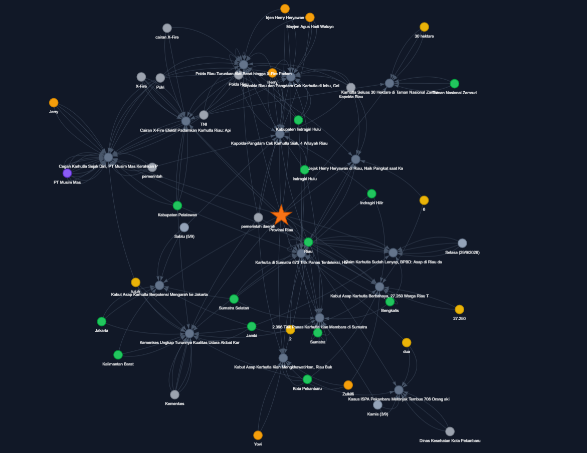

# Karhutla NER & News Knowledge Graph

Eksplorasi *Named Entity Recognition* (NER) pada berita Indonesia tentang
kebakaran hutan dan lahan (karhutla). Proyek ini menyiapkan data berita yang
sudah diberi label entitas (*silver labels*), melakukan klasterisasi entitas,
dan membangun draft knowledge graph berbasis bukti artikel.

## Preview graph



## Isi repository

- `ner_project.ipynb` — notebook eksplorasi NER, audit hasil label, klaster
  entitas, dan visualisasi graph lokal.
- `datasets/ner_silver_labeled_fulltext.csv` — artikel berita dengan entitas
  hasil NER dan confidence score.
- `datasets/ontology_draft/` — node, edge `MENTIONED_IN`, cluster entitas,
  draft kelas ontology, dan contoh graph interaktif Provinsi Riau.

## Menjalankan notebook

```bash
pip install pandas matplotlib pyvis
```

Buka `ner_project.ipynb` dengan Jupyter atau VS Code lalu jalankan cell secara
berurutan. Graph interaktif juga diekspor sebagai file HTML di
`datasets/ontology_draft/`.

## Data berita

Special thanks to [IndoNews API](https://indonewsapi.web.id/) yang menyediakan
akses berita Indonesia melalui satu API dan menjadi sumber data berita untuk
proyek ini. Kunjungi [indonewsapi.web.id](https://indonewsapi.web.id/) untuk
mencari, mengambil, dan membangun aplikasi berbasis data berita Indonesia.

## Catatan

Label pada `ner_silver_labeled_fulltext.csv` dibuat secara otomatis. Gunakan
confidence score, sumber artikel, dan potongan teks sebagai bukti saat
mengevaluasi atau membangun relasi knowledge graph.
